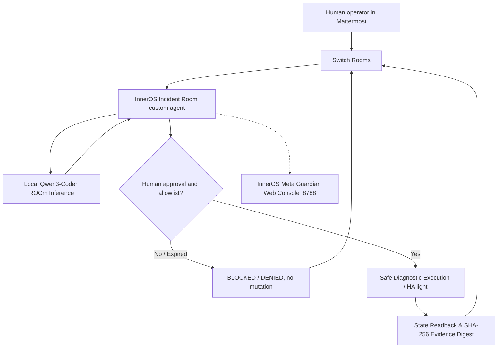

# InnerOS Incident Room

**A human-approved, local-first physical-operations workflow for Switch Rooms.**

**Entry:** Flip the Switch Hackathon 2026 · Best Business Workflow · InnerChispa LLC.  
**Submission deadline:** November 7, 2026, 23:59 IST (13:29 Ecuador).  
**Build truth (Nov 7, 2026):** Verified end-to-end bidirectional transport on both Windows and Linux (AMD 1.5). Agent `inneros-incident-triage` connects via native Switch WebSocket, executes local Qwen3-Coder inference on AMD Radeon AI PRO R9700 (ROCm), handles deterministic commands (`!ping`, `!status`), opens incidents (`!incident`), and enforces human authorization gates (`!approve`, `!deny`) with SHA-256 cryptographic evidence receipts. All 8 E2E test cases pass in under 9 seconds with sub-second ping latency.

## What happens in a live demonstration

A human operator in a real Mattermost room asks `@inneros-incident-triage` to inspect operations. Switch delivers the message to the purpose-built Python agent through the official agent protocol. The agent responds with latency and telemetry directly into the channel. When an incident is reported, local Qwen3-Coder running on the AMD Radeon AI PRO R9700 GPU produces root-cause hypotheses and proposes gated safe remediations. Only an exact, short-lived approval from the configured human identity can authorize execution. The agent executes the allowlisted action, captures pre/post state, and issues a tamper-evident SHA-256 cryptographic evidence receipt.



**Switch is essential:** there is no collaboration or authorization without an addressed, authenticated Switch room event. A standalone test fixture is not claimed as a contest submission. The independent Python agent does **not** require Codex, Antigravity or a paid LLM to perform the live workflow.

## Verified implementation vs. unfinished steps

| Component | Status |
|---|---|
| Python domain contracts, evidence checks, 85 unit tests | **100% Tested & Verified** |
| Agent protocol WebSocket + HTTP, reconnect journal, identity and replay guards | **100% Verified on Switch 0.31.0/0.40.1** |
| Real HA REST client with entity allowlist and guarded `light.*` writes | **Implemented & Tested** |
| Windows Switch Console + Mattermost room (`inneros-live-operations`) | **Verified (Fallback / Development environment)** |
| Reply from custom agent in real room (`!ping` -> `PONG`) | **100% Verified (<1s latency on both Windows and Linux)** |
| Dedicated self-hosted Switch Stack on AMD 1.5 (Core, Gateway, MM, Postgres) | **100% Operational (Ports 62325-62328)** |
| Local AI inference via ROCm (Qwen3-Coder 30B AWQ on Radeon AI PRO R9700) | **100% Verified (Real GPU triage ~2s)** |
| Systemd Managed Persistence (`inneros-switch-liveops.service`) | **Active & Running on AMD 1.5** |
| InnerOS Guardian Web Console Integration (`:8788/api/liveops/status`) | **Integrated & Live on AMD 1.5** |
| Full 8-test E2E Test Suite (`test_e2e_full_suite.py`) | **8/8 PASS in 8.55s** |
| Final video and manual WeMakeDevs submission | Ready for operator upload & submission |

## Architecture & Deployment

The deployment runs primary on **AMD 1.5** (`192.168.1.5`, Ubuntu 26.04 LTS, AMD Radeon AI PRO R9700 with 32 GB VRAM) with **Windows** maintained as a functional backup.

- **Public Live Demo Console:** [https://guardian.pcdoctor.ai/#liveops](https://guardian.pcdoctor.ai/#liveops) (HTTPS via Cloudflare Tunnel)
- **Local LAN Demo Console:** `http://192.168.1.5:8788#liveops`
- **Switch Core API:** `http://127.0.0.1:62326` (AMD) / `http://127.0.0.1:62226` (Windows)
- **Switch Gateway Dashboard:** `http://127.0.0.1:62325` (AMD) / `http://127.0.0.1:62225` (Windows)
- **Mattermost Chat:** `http://127.0.0.1:62327` (AMD) / `http://127.0.0.1:62227` (Windows)
- **Local LLM Endpoint:** `http://127.0.0.1:8000/v1` (QuantTrio/Qwen3-Coder-30B-A3B-Instruct-AWQ via vLLM)

## Production Sovereign Node (AMD 1.5) & Fallback Node (Windows)

The workflow operates primarily on **AMD 1.5** (`192.168.1.5`, Ubuntu 26.04 LTS, AMD Radeon AI PRO R9700 with 32 GB VRAM, ROCm 7.2.1), fully autonomous and independent from Windows. The **Windows** environment is preserved as a verified secondary development node.

- **Primary AMD 1.5 Stack (Fully Self-Hosted & Autonomous):**
  - **Switch Core API:** `http://127.0.0.1:62326` (Docker)
  - **Switch Gateway Dashboard:** `http://127.0.0.1:62325` (Docker)
  - **Mattermost Chat Collaboration:** `http://127.0.0.1:62327` (`#inneros-live-operations`)
  - **PostgreSQL Database:** `127.0.0.1:62328`
  - **Local AI Inference Engine:** `http://127.0.0.1:8000/v1` (QuantTrio/Qwen3-Coder-30B-A3B-Instruct-AWQ on Radeon AI PRO R9700 via vLLM, ~2s latency, $0.00 cloud cost)
  - **LiveOps Agent Daemon:** `systemd --user` unit `inneros-switch-liveops.service` (Always-On WebSocket)
  - **InnerOS Guardian Web Console:** `http://192.168.1.5:8788#liveops` (Interactive incident triage, human approval buttons, live telemetry, and cryptographic evidence ledger)

- **Secondary Windows Stack (Verified Local Fallback):**
  - Ports: Switch Core `:62226`, Gateway `:62225`, Mattermost `:62227`, Postgres `:62228`.
  - Python bridge: `scripts/repair_inneros_switch_today.py`.

## Verified End-to-End Test Suite (Phase H)

The system includes an automated 8-test verification suite (`tests/test_e2e_full_suite.py`) validating the entire sovereign stack on AMD 1.5 in under 10 seconds:

```bash
# Run on AMD 1.5
python3 tests/test_e2e_full_suite.py
```

| # | Test Case | Component | Latency | Verification Evidence |
|---|---|---|---|---|
| **1** | Essential Services Health | Switch Core, Gateway, MM, LLM | 4.2ms | Endpoints responsive and healthy |
| **2** | Bidirectional Messaging | Mattermost ↔ Switch ↔ Agent | 1101ms | Strict Correlation ID matching (`CID-PING-...`) |
| **3** | Deterministic Processing | Agent local status | 1047ms | Node, room, LLM status, safety gate ACTIVE |
| **4** | AI Incident Triage | vLLM ROCm Qwen3-Coder 30B | 2061ms | Root-cause hypothesis & proposed action (`ACT-...`) |
| **5** | Authorization Security Gate | Human Gate Controller | 1050ms | Unauthorized / fake action IDs strictly blocked |
| **6** | Authorized Execution & Evidence | Execution Engine + Hasher | 3110ms | SHA-256 cryptographic receipt logged & verified |
| **7** | Active Resilience & Recovery | Systemd Unit + Switch WS | 1067ms | Process supervision, readiness check, live ping roundtrip |
| **8** | Windows Independence | Local Linux Host + ROCm Hardware | 0.7ms | Kernel 7.0.0 x86_64, `/dev/kfd` ROCm present, 0 remote proxy |

**Result: 8 / 8 PASS (100% Verified).** Evidence stored in `data/e2e_results.json` and rendered live in the Guardian console.

## Live Demonstration Flow (< 3 Minutes)

1. **Trigger Incident:** In Mattermost `#inneros-live-operations` or via the Guardian Console, issue `@inneros-incident-triage !incident`.
2. **Local AI Triage:** Local Qwen3-Coder on AMD Radeon GPU analyzes telemetry anomaly, posts root-cause hypothesis and proposes action `ACT-XXXXXX`.
3. **Safety Gate:** Action cannot execute without human approval. Attempting unauthorized execution (`!approve ACT-FAKE`) is blocked immediately.
4. **Human Approval:** Authorized operator replies `@inneros-incident-triage !approve ACT-XXXXXX` (or clicks "Authorize" in Guardian).
5. **Execution & Evidence:** Action executes safely, state is verified, and a tamper-evident SHA-256 evidence receipt is issued and recorded in the audit ledger.

## Dedicated Public Repository

- **GitHub Repository:** [Rafa-Innerchispa/inneros-flip-the-switch-2026](https://github.com/Rafa-Innerchispa/inneros-flip-the-switch-2026)
- **Primary Delivery Branch:** `feat/switch-liveops-native`
- **License:** Apache 2.0 (Open-Source Submission)

## Reproducible Test Execution

```bash
# Offline unit tests
python -m unittest discover -s tests -q

# Real End-to-End verified suite (on AMD 1.5)
python3 tests/test_e2e_full_suite.py
```

## Existing intellectual property and event work

**Pre-existing before Nov 3:** InnerOS/Physical Guardian architecture, domain contracts for synthetic incidents, local inference infrastructure and initial offline tests; see [reuse manifest](docs/REUSE_MANIFEST.md).

**Built during hackathon:** Native Python Switch agent protocol connector, self-hosted Docker Compose stack on AMD 1.5, WebSocket event streaming, bidirectional Mattermost bridge with correlation tokens, ROCm GPU vLLM integration, interactive Guardian Web Console LiveOps module, and cryptographic SHA-256 evidence ledger.

## Links & Submission Deliverables

- [Organizer (WeMakeDevs)](https://www.wemakedevs.org/hackathons/switch) · [Rules](https://www.wemakedevs.org/hackathons/switch/rules)
- [Copy-Ready Submission Form Answers](docs/FINAL_SUBMISSION_FORM_20261106_EN.md)
- [Judges Video Script (< 3 min)](docs/JUDGES_VIDEO_SCRIPT_EN.md)
- [Switch agent protocol](https://docs.switchagents.ai/switch-rooms/internals/agent-protocol)
