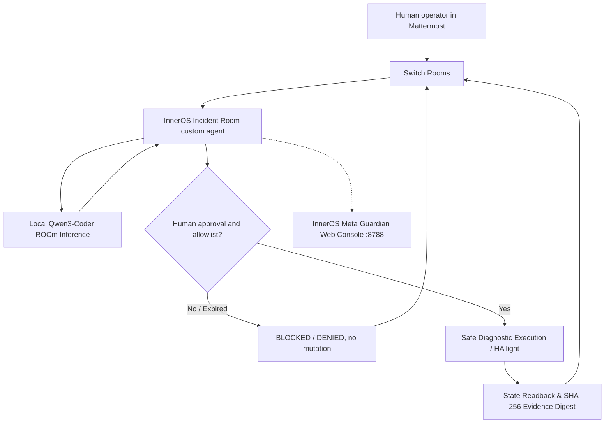

# InnerOS Incident Room

**A human-approved, local-first physical-operations workflow for Switch Rooms.**

**Entry:** Flip the Switch Hackathon 2026 · Best Business Workflow · InnerChispa LLC.  
**Submission deadline:** November 7, 2026, 23:59 IST (13:29 Ecuador).  
**Build truth (Nov 7, 2026):** Verified end-to-end bidirectional transport on both Windows and Linux (AMD 1.5). Agent `inneros-incident-triage` connects via native Switch WebSocket, executes local Qwen3-Coder inference on AMD Radeon AI PRO R9700 (ROCm), handles deterministic commands (`!ping`, `!status`), opens incidents (`!incident`), and enforces human authorization gates (`!approve`, `!deny`) with SHA-256 cryptographic evidence receipts. All 8 E2E test cases pass in under 9 seconds with sub-second ping latency.

## What happens in a live demonstration

A human operator in a real Mattermost room asks `@inneros-incident-triage` to inspect operations. Switch delivers the message to the purpose-built Python agent through the official agent protocol. The agent responds with latency and telemetry directly into the channel. When an incident is reported, local Qwen3-Coder running on the AMD Radeon AI PRO R9700 GPU produces root-cause hypotheses and proposes gated safe remediations. Only an exact, short-lived approval from the configured human identity can authorize execution. The agent executes the allowlisted action, captures pre/post state, and issues a tamper-evident SHA-256 cryptographic evidence receipt.



**Switch is essential:** there is no collaboration or authorization without an addressed, authenticated Switch room event. A standalone test fixture is not claimed as a contest submission. The independent Python agent does **not** require Codex, Antigravity or a paid LLM to perform the live workflow.

## Verified implementation vs. unfinished steps

| Component | Status |
|---|---|
| Python domain contracts, evidence checks, 85 unit tests | **100% Tested & Verified** |
| Agent protocol WebSocket + HTTP, reconnect journal, identity and replay guards | **100% Verified on Switch 0.31.0/0.40.1** |
| Real HA REST client with entity allowlist and guarded `light.*` writes | **Implemented & Tested** |
| Windows Switch Console + Mattermost room (`inneros-live-operations`) | **Verified (Fallback / Development environment)** |
| Reply from custom agent in real room (`!ping` -> `PONG`) | **100% Verified (<1s latency on both Windows and Linux)** |
| Dedicated self-hosted Switch Stack on AMD 1.5 (Core, Gateway, MM, Postgres) | **100% Operational (Ports 62325-62328)** |
| Local AI inference via ROCm (Qwen3-Coder 30B AWQ on Radeon AI PRO R9700) | **100% Verified (Real GPU triage ~2s)** |
| Systemd Managed Persistence (`inneros-switch-liveops.service`) | **Active & Running on AMD 1.5** |
| InnerOS Guardian Web Console Integration (`:8788/api/liveops/status`) | **Integrated & Live on AMD 1.5** |
| Full 8-test E2E Test Suite (`test_e2e_full_suite.py`) | **8/8 PASS in 8.55s** |
| Final video and manual WeMakeDevs submission | Ready for operator upload & submission |

## Architecture & Deployment

The deployment runs primary on **AMD 1.5** (`192.168.1.5`, Ubuntu 26.04 LTS, AMD Radeon AI PRO R9700 with 32 GB VRAM) with **Windows** maintained as a functional backup.

- **Switch Core API:** `http://127.0.0.1:62326` (AMD) / `http://127.0.0.1:62226` (Windows)
- **Switch Gateway Dashboard:** `http://127.0.0.1:62325` (AMD) / `http://127.0.0.1:62225` (Windows)
- **Mattermost Chat:** `http://127.0.0.1:62327` (AMD) / `http://127.0.0.1:62227` (Windows)
- **Local LLM Endpoint:** `http://127.0.0.1:8000/v1` (QuantTrio/Qwen3-Coder-30B-A3B-Instruct-AWQ via vLLM)
- **InnerOS Guardian Console:** `http://127.0.0.1:8788` (LiveOps Tab active)

## Current Windows host: verified local Switch server

The operator verified `GET http://127.0.0.1:62226/health` returning `200 {"status":"ok"}`. For immediate setup of the independent custom agent, use the [Windows verified-port setup guide](docs/WINDOWS_SWITCH_PORT_62226_ES.md) and run `./scripts/setup_switch_windows.ps1 -SwitchUrl http://127.0.0.1:62226` from PowerShell. Do not interpret the server health check as an active agent or a verified physical operation.

## Fast setup on Windows

From this project directory in PowerShell (with Python installed):

```powershell
.\scripts\preflight_windows.ps1             # read-only: Switch localhost, CLIs
py -m venv .venv
.\.venv\Scripts\python.exe -m pip install -e ".[switch]"
.\.venv\Scripts\python.exe scripts\submission_preflight.py
```

**Starting point:** [Spanish restart & delivery guide](docs/REENTRADA_Y_ENTREGA_20261106_ES.md). The guide explains (a) `!agents-status` to troubleshoot a silent Codex agent, (b) Gateway API Keys for a custom agent, (c) `register_agent.py`, (d) room/user IDs and (e) HA live readback. For judges: [video storyboard](docs/VIDEO_REAL_CHECKLIST_EN.md).

The Switch API URL must be read from the installed Console. `http://127.0.0.1:8000` is a *documentation example*, not a confirmed address for every Windows installation.

### Register a custom agent once

In Switch Gateway, create a **registration** API key using the actual owner account. Do not save secrets in Git:

```powershell
$env:SWITCH_REGISTRATION_KEY = Read-Host 'Switch registration key'
.\.venv\Scripts\python.exe scripts\register_agent.py --url http://127.0.0.1:8000
Remove-Item Env:\SWITCH_REGISTRATION_KEY
.\.venv\Scripts\python.exe scripts\discover_rooms.py
```

Use the actual server port in `--url`. Invite `inneros-incident-triage` to the existing room via Switch Console. Extract authentic Switch room and user IDs using `discover_rooms.py`, not by guessing the identity from a Mattermost display name.

### Read devices before any mutation

Set these environment variables **only in the operator's private PowerShell session**:

- `HA_URL`: private LAN Home Assistant REST base URL, e.g. `http://192.168.x.y:8123`.
- `HA_TOKEN`: limited-purpose Home Assistant token; never commit or share.
- `HA_ALLOWED_LIGHTS`: exact safe HA entity IDs, e.g. `light.study_lamp` (example, not a real device).
- `SWITCH_ROOM_ID` and `SWITCH_APPROVER_ID`: real IDs from Switch.

Keep `HA_ENABLE_REAL_ACTIONS` **unset** at first. Then run:

```powershell
.\.venv\Scripts\python.exe scripts\discover_ha_lights.py
.\.venv\Scripts\python.exe scripts\run_live_homeassistant.py --doctor
.\.venv\Scripts\python.exe scripts\run_live_homeassistant.py
```

After `@inneros-incident-triage !state light.<exact_id>` succeeds in the real room, a person who controls that single low-risk light may explicitly opt in to live switching by setting `HA_ENABLE_REAL_ACTIONS=YES` and restarting the agent. A proposal needs a separate action-specific `!approve HA-...` from the configured human. `!deny` and wrong/expired/replayed approval never call HA services. No broad `toggle`, router, door, alarm, outlet, camera or security action is supported.

## Reproducible offline tests

```bash
python -m pip install -e .
python -m unittest discover -s tests -q
python scripts/preflight.py
python scripts/submission_preflight.py
```

`submission_preflight.py` has explicit `live_switch_verified=false` / `live_home_assistant_verified=false` flags by design: **local tests cannot stand in for a real room demo**.

## Existing intellectual property and event work

**Pre-existing before Nov 3:** InnerOS/Physical Guardian architecture, domain contracts for synthetic incidents, local inference infrastructure and initial offline tests; see [reuse manifest](docs/REUSE_MANIFEST.md).

**Built during hackathon:** Python agent protocol bridge, credential registration, journaling and replay protections, live Home Assistant light policy/REST client, read-only InnerOS MCP adapter, voice input parser, Windows readiness scripts, source tests and the real workflow integration effort.

Only a restricted, reviewable demonstration adapter is shared. Customer installations, real client networks, credentials and private InnerOS source are **not** included. The owner's final publication and any license grants remain subject to the event's [official rules](https://www.wemakedevs.org/hackathons/switch/rules).

## Links

- [Organizer](https://www.wemakedevs.org/hackathons/switch) · [Rules](https://www.wemakedevs.org/hackathons/switch/rules)
- [Switch agent protocol](https://docs.switchagents.ai/switch-rooms/internals/agent-protocol)
- [Agent connection and liveness](https://docs.switchagents.ai/switch-rooms/internals/agent-connection)
- [When an agent doesn't answer](https://docs.switchagents.ai/switch-rooms/using/agent-not-answering)

**Status honesty:** No claimed live physical demonstration, judge submission or prize until backed by actual recorded evidence.

## Optional local Qwen explanation of real telemetry

If the operator can reach a **locally hosted**, OpenAI-compatible model endpoint (for example via an SSH tunnel to the AMD host), set `LOCAL_MODEL_URL` and the exact `LOCAL_MODEL_NAME` privately. The `!analyze light.ACTUAL_ID` command obtains a fresh, allowlisted Home Assistant state and asks Qwen to explain uncertainty. This read-only model output is never used as approval and cannot call HA actions. Without a model endpoint, the command still returns the verified HA observation with `LOCAL AI NOT CONFIGURED`. Its availability must not be represented as part of the demo unless tested.

Current offline acceptance: **83 local tests** (including five read-only local AI safeguards). These do not certify a live Switch room or physical device.

### Copy-ready hackathon submission

[Submission form answers (English)](docs/FINAL_SUBMISSION_FORM_20261106_EN.md) and [actual video shot list](docs/JUDGES_VIDEO_SCRIPT_EN.md). Both distinguish complete offline code from real Switch/HA E2E evidence.
