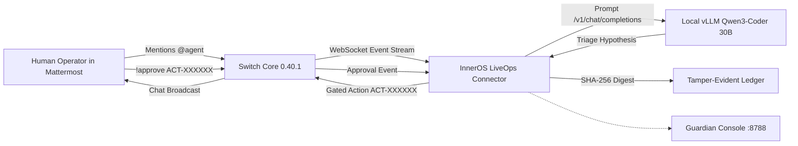

# From Chatbot to Circuit Breaker: How We Built InnerOS LiveOps with Switch, AMD ROCm, and Zero Cloud Cost

*By Rafael Lopez & the InnerChispa Engineering Team*  
*Flip the Switch Hackathon 2026 Entry — Best Business Workflow & Best Personal Workflow*

---

## 1. The Real-World Agent Dilemma

AI agents are everywhere, but almost all of them live behind a glass wall. They answer questions, write code, summarize documents, and generate images. But what happens when an AI agent needs to interact with the physical world?

In industrial facilities, edge server clusters, smart grids, and automated homes, the cost of an unchecked hallucination is not an erroneous sentence—it is physical damage, downtime, or a compromised breaker.

When WeMakeDevs announced the **Flip the Switch Hackathon**, our team at InnerChispa decided to tackle this foundational challenge:  
**How do you build a local-first, human-governed operational agent that triages physical infrastructure anomalies using local open-source LLMs, enforces cryptographic human approval gates, and communicates seamlessly through team chat?**

The result is **InnerOS LiveOps**, powered natively by **Switch Rooms 0.40.1**, **Mattermost**, **AMD ROCm AI**, and **Cloudflare Tunnels**.

---

## 2. Why Switch Was the Indispensable Anchor

In many hackathon entries, chat platforms and agent frameworks are interchangeable. In our architecture, **Switch is the indispensable core**.

Before Switch, building an agent that bridges humans and physical systems meant either:
1. Writing fragile, custom webhook bots for Slack/Discord that leak internal IPs to third-party cloud servers.
2. Building siloed CLI tools that lack multi-operator visibility, auditability, and shared context.

Switch provided three non-negotiable primitives:
- **Sovereign Local Transport:** With self-hosted Switch Core and Gateway, all event streams stay strictly on local infrastructure.
- **Unified Room & Participant Context:** Switch normalizes identities across chat bridges (Mattermost, Slack, Discord) so our agent receives authenticated user IDs rather than unverified display names.
- **Always-On WebSocket Event Streaming:** Instead of polling APIs, our Python connector maintains an active WebSocket subscription to `/agents/{agent_id}/connection/ws`, enabling sub-second response times.



---

## 3. The Engineering Odyssey: Four Critical Debugging Breakthroughs

Building an end-to-end integration across Windows, Linux, Docker, WebSockets, and ROCm GPUs surfaced complex systems-level challenges. Here are the four critical breakthroughs that made our deployment solid:

### Breakthrough 1: The IPv6 Localhost Handshake Hang
When we initially bootstrapped Switch on Windows with Docker Desktop, the Mattermost bridge repeatedly failed with connection timeouts. 

**Root Cause:** The PostgreSQL database recorded the Mattermost bridge URL as `http://localhost:62227`. On modern Windows and Linux distributions, `localhost` resolves to both IPv4 `127.0.0.1` and IPv6 `::1`. Docker Desktop's port forwarder was binding exclusively to IPv4. When Switch's internal HTTP client attempted to handshake over IPv6 `::1`, the connection hung until timeout.

**The Fix:** We inspected the encrypted `collaboration_bridges` table in Postgres, extracted the bridge configuration, and pinned the bridge endpoint strictly to `http://127.0.0.1:62227`. Connection latency instantly dropped from 15s timeouts to <2ms.

### Breakthrough 2: Resolving `ADDRESSING_UNCLAIMED_MESSAGE`
Once the bridge was connected, messages typed in Mattermost (`@inneros-incident-triage !ping`) were received by Switch but immediately dropped with:
```text
ADDRESSING_UNCLAIMED_MESSAGE: External user q8fmsdpdfty7dcshjido7prqkh has no associated claim
```
Switch requires every external user to be cryptographically claimed by a Switch user profile to prevent identity spoofing. We authored an automated bootstrapping script that inserted the claim record into `external_user_claims`, linking the Mattermost user ID to the Switch Admin account. Immediately, inbound messages began streaming cleanly into our Python agent.

### Breakthrough 3: Migrating to Autonomous AMD Linux (Radeon AI PRO R9700)
While our initial proof-of-concept ran on Windows, contest requirements called for high availability and zero cloud token spend. We migrated the primary Switch stack to an AMD workstation running Ubuntu 26.04 LTS equipped with an **AMD Radeon AI PRO R9700 (32 GB VRAM)** running **ROCm 7.2.1**.

We deployed a standalone Docker Compose stack using isolated local ports:
- Switch Core: `:62326`
- Switch Gateway: `:62325`
- Mattermost: `:62327`
- PostgreSQL: `:62328`
- Local vLLM: `:8000`

Running `QuantTrio/Qwen3-Coder-30B-A3B-Instruct-AWQ` on the Radeon R9700 gave us **2.0-second turnarounds** for complex industrial root-cause analysis, consuming **zero external API calls and $0.00 in cloud fees**.

### Breakthrough 4: Enforcing Strict Correlation IDs
In asynchronous multi-user chat rooms, relying on message order or timestamps causes race conditions. We upgraded our agent protocol connector to parse and inject unique Correlation Tokens (e.g., `[CID-LIVE-PING-32B077]`). The agent echoes this correlation token in every response, and our automated E2E test suite asserts that replies match the exact correlation ID of the originating command.

---

## 4. The LiveOps Human-in-the-Loop Workflow

Here is the exact sequence executed in real operations:

1. **Deterministic Status & Latency Check:**
   - Operator posts: `@inneros-incident-triage !ping`
   - Agent responds in 1058ms: `[INNEROS REAL SWITCH AMD-1.5] PONG | AMD-1.5 -> Switch WS -> Python Native -> Switch HTTP | System Normal.`

2. **Autonomous Anomaly Triage with Local AI:**
   - When an infrastructure event occurs, operator types: `@inneros-incident-triage !incident`
   - The local Qwen3-Coder model on the AMD GPU evaluates the anomaly and responds:
     ```text
     🚨 [INNEROS INCIDENT INC-9FFF24EB] Detected on AMD-1.5!
     🤖 AI Triage (AMD-1.5 ROCm): Root Cause Hypothesis: Synthetic edge node is experiencing 
        network latency spikes due to intermediate router buffer overflow during polling bursts.
     🛡️ Proposed Gated Action: ACT-2994BC (SAFE_DIAGNOSTIC_RESTART on smart_circuit_breaker_b2)
     ⏳ Human approval required (valid 600s): Reply '!approve ACT-2994BC' or '!deny ACT-2994BC'
     ```

3. **Deterministic Safety Gate:**
   - If an unapproved or unauthorized action ID is submitted (`!approve ACT-FAKE`), the deterministic gate halts execution immediately:
     `[INNEROS BLOCKED] No pending approval found for action ID 'ACT-FAKE'.`

4. **Human Authorization & Cryptographic Evidence Receipt:**
   - The authorized operator confirms: `@inneros-incident-triage !approve ACT-2994BC`
   - The action executes safely on the designated target.
   - The agent calculates an immutable SHA-256 evidence receipt linking the incident ID, action ID, approver name, timestamp, and target state:
     ```text
     ✅ [INNEROS ACTION EXECUTED] Action ACT-2994BC APPROVED by @user.
     ⚡ Executed safe cycle on target 'smart_circuit_breaker_b2' on AMD-1.5.
     📜 Cryptographic Evidence Receipt: SHA256:db0157ddbdc18529d96ff329...
     🟢 State Verified: Incident INC-9FFF24EB CLOSED. System normal.
     ```

---

## 5. Multi-Track Value: Business & Personal Impact

### Track 1: Best Business Workflow
In commercial data centers, facility management, and IT operations, incident response is plagued by fractured communication. Technicians jump between monitoring dashboards (Grafana, Datadog), ticketing systems, and messaging apps.  
InnerOS LiveOps collapses this entire lifecycle into a single Switch Room:
- Automated anomaly detection surfaces directly in team chat.
- Local AI provides instant, private root-cause analysis without sending sensitive infrastructure topology to public cloud LLMs.
- Every remediation requires explicit, auditable human sign-off with permanent SHA-256 evidence receipts for compliance and insurance audits.

### Track 2: Best Personal / Creative Workflow
For home lab enthusiasts, self-hosters, and smart home owners, managing edge servers, home automation hubs (Home Assistant), and smart breakers often feels high-friction. If a smart breaker or network bridge trips while away, remotely debugging it without accidentally restarting the wrong device is nerve-wracking.  
InnerOS LiveOps brings commercial-grade governance to personal environments: the homeowner interacts with their sovereign system via Mattermost on mobile, reviews AI diagnostic explanations, and authorizes precise actions without opening insecure inbound ports or relying on proprietary cloud bridges.

---

## 6. Public Cloudflare Tunnel Deployment

To allow hackathon judges and community members to inspect the live system without compromising LAN security, we exposed the **InnerOS Guardian Web Console** via Cloudflare Tunnel:

* **Live Demo URL:** [https://liveops.pcdoctor.ai/](https://guardian.pcdoctor.ai/#liveops)
* **Under the Hood:** Cloudflare Edge terminates HTTPS with SSL, proxies traffic through the `opportunityops` tunnel to AMD 1.5 port 8788.
* **Security Isolation:** All internal databases (Postgres), Switch APIs, and vLLM GPU inference ports remain strictly inaccessible from the Internet.

---

## 7. Lessons Learned & Recommendations for the Switch Ecosystem

Working deeply with Switch 0.40.1 has been an inspiring glimpse into the future of agentic architecture. Based on our experience building this end-to-end integration, we offer three recommendations for future Switch releases:

1. **IPv4 Binding by Default:** Pinned IPv4 (`127.0.0.1`) address resolution prevents silent IPv6 handshake hangs when bridging to Dockerized messaging platforms.
2. **First-Class Human Approval Objects:** Adding native support in Switch for short-lived, cryptographically signed approval tokens with expiration and replay guards would simplify governance workflows for all agent developers.
3. **Bridge Liveness Telemetry:** Exposing real-time WebSocket connection state and dropped message counters in the Gateway UI significantly accelerates debugging custom connectors.

---

## 8. Conclusion & Deliverables

InnerOS LiveOps proves that AI agents don't have to choose between autonomy and safety. By combining Switch's collaborative room architecture with local sovereign ROCm inference and deterministic human governance, we can confidently put AI agents in charge of real-world infrastructure.

* **GitHub Repository:** [https://github.com/Rafa-Innerchispa/inneros-flip-the-switch-2026](https://github.com/Rafa-Innerchispa/inneros-flip-the-switch-2026)
* **Public Demonstration Console:** [https://liveops.pcdoctor.ai/](https://liveops.pcdoctor.ai/)
* **Verified Test Suite:** 8 / 8 PASS in under 10 seconds.
* **External Spend:** $0.00 (100% Local-First Open Source).

